  

  

---

### 🕹️ Contribution Activity

  <picture>
    <source media="(prefers-color-scheme: dark)" srcset="https://raw.githubusercontent.com/ghoshArgha94-ops/ghoshArgha94-ops/output/pacman-contribution-graph-dark.svg">
    <source media="(prefers-color-scheme: light)" srcset="https://raw.githubusercontent.com/ghoshArgha94-ops/ghoshArgha94-ops/output/pacman-contribution-graph.svg">
    
  </picture>

---

### 🛠️ Tech Stack & Tools

  

---

### 📊 GitHub Analytics

  
  

  

